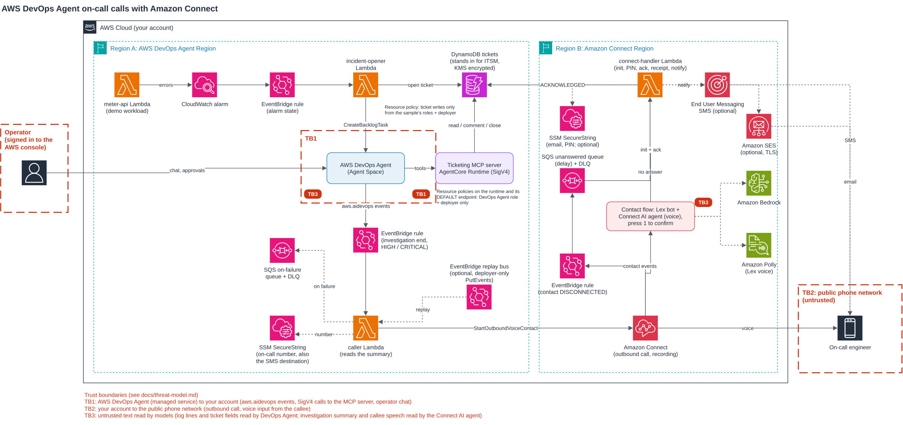

# AWS DevOps Agent on-call calls with Amazon Connect

This sample shows two patterns around [AWS DevOps Agent](https://aws.amazon.com/devops-agent/):

1. **A custom MCP server**: the operator reads and updates the incident ticket from the DevOps Agent
   chat, through a ticketing MCP server on Amazon Bedrock AgentCore Runtime. Every write needs a
   human approval.
2. **An on-call call at the end of the investigation**: a CloudWatch alarm opens a ticket and an
   investigation; when the investigation ends, Amazon Connect calls the on-call engineer. A Connect
   AI agent summarizes what DevOps Agent found, answers questions, and acknowledges the ticket
   when the engineer says they take the incident.

Everything is deployed with Terraform (`hashicorp/aws` and `hashicorp/awscc`).

> **Disclaimer:** this is sample code for demonstration and educational purposes only, not for
> production use. You should work with your own security and legal teams to meet your
> organization's security, regulatory and compliance requirements before deployment. Deploying it
> creates billable resources and places real phone calls (see [Costs](#costs)). Read
> [Security considerations](#security-considerations) before calling real people: a pilot with
> real on-call staff needs a dedicated AWS account.

## Architecture



1. A CloudWatch alarm on the errors of the demo workload (`meter-api` Lambda function) fires. An EventBridge rule
   invokes `incident-opener`, which writes a ticket (DynamoDB, standing in for your ITSM tool) and
   starts an AWS DevOps Agent investigation (`CreateBacklogTask`).
2. When the investigation ends, AWS DevOps Agent emits an `aws.aidevops` event. A rule filtered on
   `detail-type` and priority (HIGH, CRITICAL) invokes the `caller` Lambda function.
3. `caller` finds the ticket, reads the investigation summary (`ListJournalRecords`), stores the
   sanitized summary on the ticket, and calls `StartOutboundVoiceContact` with the short incident
   context (ticket, service, priority, status) as contact attributes. The Amazon Connect
   instance can be in another Region. If no ticket is linked to the investigation (for example one
   started by hand, outside `incident-opener`), no call is placed: the invocation fails, is retried
   once, then lands in the caller's failure queue.
4. The contact flow announces the incident and asks the engineer to press 1 (a short second prompt
   if needed). On 1, it copies the context into a Connect AI agent session (`connect-handler`,
   action `init`) and hands the call to the AI agent through a Lex bot. If 1 is not pressed
   (voicemail, or answered without pressing 1), `connect-handler` (action `notify`) comments the
   ticket and sends the optional SMS and/or email (the in-flow path). A call that is never answered
   or that the engineer hangs up before the flow runs (busy, no answer, rejected, early hang-up) has
   no flow invocation: an EventBridge rule on the Amazon Connect contact event `DISCONNECTED`
   (API-initiated, channel `VOICE`, this instance) sends the event to an SQS queue with a delay
   (longer than the lease and the acknowledgment grace, so a late press-1 or acknowledgment wins the
   race), and the queue invokes the same `notify` path on `connect-handler`. The queue has a
   dead-letter queue with a CloudWatch alarm on the dead-letter queue depth, so a run of handler
   failures is visible rather than silent. The rule has no timestamp filter: `connect-handler`
   reads `connectedToSystemTimestamp` from the event to derive the reason, a present timestamp means
   the call was answered but not acknowledged (`not_acknowledged`: hang-up, decline, fallback), its
   absence means the call never connected (`not_connected`). The in-flow path (answered but 1 not
   pressed) uses `no_answer`. When the engineer takes the incident, the agent
   returns the `Acknowledge` tool, the flow asks "to confirm you take incident X, press 1", and only
   on 1 does `connect-handler` write `ACKNOWLEDGED` (`ackMethod: voice+dtmf`). Without the 1 the call
   ends, the ticket stays OPEN and the contact-event path sends the normal SMS/email. After an
   acknowledgment the same path sends one written receipt ("you acknowledged INC-x at T"); an
   acknowledged ticket is never called or notified again.
5. In the DevOps Agent chat, the operator reads and updates the ticket through the ticketing MCP
   server (Amazon Bedrock AgentCore Runtime, SigV4). Read tools are `READ_ONLY`, write tools are
   `MUTATIVE` and need approval.

The diagram source is `docs/architecture.drawio` (generated by `scripts/dev/gen_diagram.py`).

More detail:
- [docs/mcp-server.md](docs/mcp-server.md): the ticketing MCP server, tool classification results,
  why AgentCore Runtime, and how to point it at a real ITSM tool.
- [docs/terraform.md](docs/terraform.md): module layout, inputs, provider gaps and their
  workarounds, Terraform gotchas, day-2 operations.
- [docs/threat-model.md](docs/threat-model.md): STRIDE threats, mitigations, accepted risks and
  production actions.

## Prerequisites

- An AWS DevOps Agent Agent Space, associated with the account (created by hand in the DevOps Agent
  console, not by this stack), and an Amazon Connect instance with a claimed phone number and
  outbound calls enabled. They can be in different Regions. No instance yet: set
  `create_connect_instance = true` and the stack creates one (`terraform/modules/connect-instance`)
  with outbound calls, flow logs and call recording storage (S3, KMS), and claims a number
  (`connect_phone_country_code`, `connect_phone_type`, US DID by default; some countries require
  regulatory documents before a number can be claimed). It does not create users or queues, which
  the on-call call does not need. The Agent Space stays a manual step either way.
- Pick `connect_region` for the country of the on-call number: a new instance can only call a
  short default list of countries (US East and US West: United States, Canada, Mexico, Puerto Rico,
  United Kingdom; EU (Frankfurt) and EU (London): United Kingdom, Italy, France, Ireland, United
  States). Otherwise the caller fails with `DestinationNotAllowedException` and you need a
  [country allowlisting service quota request](https://docs.aws.amazon.com/connect/latest/adminguide/country-code-allow-list.html).
  Changing `connect_region` on a deployed stack does not work in place (the refresh fails on the
  integration associations): destroy, then deploy again.
- The Connect instance needs AI agents (Amazon Connect Customer tier) and its single
  `WISDOM_ASSISTANT` integration slot free: it must not already have an AI agents assistant.
  On a supplied instance (`create_connect_instance = false`) the stack adds an AI agents
  assistant association, a Lex bot association, a Lambda function association and a contact flow;
  `terraform destroy` removes them. No existing resource of the instance is edited.
- Amazon Bedrock access to Claude Haiku 4.5 through the cross-Region inference profile of the
  Connect Region's geography (`eu.`, `us.` or `apac.`, override with the module `model_id`).
- Optional, for the no-answer notification (Connect Region): an AWS End User Messaging SMS
  origination identity (phone number, pool or sender ID, registered for the destination country)
  and/or an Amazon SES verified sender address (`notify_email_from` is an address, not a bare
  domain). Without them, a call that is not acknowledged only comments the ticket.
- Terraform >= 1.9, AWS CLI 2.36.47 or later (the classification script needs the DevOps Agent
  `toolDetails` and `preferences` parameters), Python 3.13 and [uv](https://docs.astral.sh/uv/) or pip.

## Regions

Two Regions are in play and they can differ: the DevOps Agent Region (`agent_space_region`, the
default provider Region) and the Connect Region (`connect_region`). Where each service must live:

| Service | Region | Notes |
|:--|:--|:--|
| AWS DevOps Agent Agent Space | DevOps Agent Region | The Agent Space is a manual input; create it in a Region where DevOps Agent is available (see the [AWS DevOps Agent endpoints and quotas](https://docs.aws.amazon.com/general/latest/gr/devops-agent.html) and the [Region table](https://aws.amazon.com/about-aws/global-infrastructure/regional-product-services/) for the current list). `foundation` and `mcp-ticketing` deploy here. |
| Amazon Bedrock AgentCore Runtime (MCP server) | DevOps Agent Region | Must be a Region where AgentCore Runtime is available (see [Amazon Bedrock AgentCore supported Regions](https://docs.aws.amazon.com/bedrock-agentcore/latest/devguide/supported-regions.html) and the [AgentCore endpoints and quotas](https://docs.aws.amazon.com/general/latest/gr/bedrock-agentcore.html)). |
| Amazon Connect instance and the outbound call | Connect Region | Pick it for the country of the on-call number (see the allow-list below). |
| Connect AI agents (Amazon Q in Connect) | Connect Region | The instance must support AI agents (Amazon Connect Customer tier); confirm AI agents are available in your Connect Region (see [Enable AI agents](https://docs.aws.amazon.com/connect/latest/adminguide/enable-q.html) and the [Amazon Connect endpoints and quotas](https://docs.aws.amazon.com/general/latest/gr/connect-service.html)). |
| Amazon Bedrock model and inference profile | Connect Region's geography | The Connect AI agent reaches Claude Haiku 4.5 through the cross-Region inference profile whose prefix matches the Connect Region's geography (`eu.`, `us.` or `apac.`). A geography-tied profile routes to several Regions inside that geography; the exact source and destination Regions are listed per profile on the [supported cross-Region inference profiles](https://docs.aws.amazon.com/bedrock/latest/userguide/inference-profiles-support.html) page, confirm them for your geography. The cross-Region inference profile routing and the geography-prefix rule are documented in [Increase throughput with cross-Region inference](https://docs.aws.amazon.com/bedrock/latest/userguide/cross-region-inference.html). |
| AWS End User Messaging SMS origination identity | Connect Region | Optional notification channel. SMS and the SSM parameter live next to `connect-handler`. |
| Amazon SES verified sender | Connect Region | Optional notification channel. SES is available in the common Connect Regions (verified: eu-central-1, eu-west-2, us-east-1, us-west-2 among others). |

The boto3 Lambda layer is built and published in the Connect Region and attached to
`connect-handler` (see [docs/terraform.md](docs/terraform.md)).

A new Connect instance can only call a short default list of countries, which depends on the
Region it was created in (from the Connect country allow-list doc, which has the current list):

| Connect Region of the instance | Countries callable by default |
|:--|:--|
| US East, US West (and Canada Central, GovCloud US-West) | United States, Canada, Mexico, Puerto Rico, United Kingdom |
| EU (Frankfurt), EU (London) | United Kingdom, Italy, France, Ireland, United States |
| Africa (Cape Town) | South Africa, United Kingdom, United States |
| Asia Pacific (Singapore) | Singapore, Australia, Hong Kong, United States, United Kingdom |

Other Regions have their own short lists; the full table is in the AWS doc. Calling a country that
is not on the list fails with `DestinationNotAllowedException` until you file a
[country allowlisting service quota request](https://docs.aws.amazon.com/connect/latest/adminguide/country-code-allow-list.html).
Existing instances may differ because the quotas changed over time.

## Data handling

What leaves the account or moves between Regions, so you can judge it against your own rules:

- **Investigation summary**: `caller` reads it from the DevOps Agent journal, sanitized with the
  shared sanitizer `src/common/sanitize.py` (NFKC normalization; invisible, control, private-use and unassigned code points dropped; ASCII and Unicode bracket and brace look-alikes and back-ticks stripped; dash-class and `= # ~ * _` runs and the fence phrase removed; length capped), and stores it
  on the ticket item (attribute `summary`). It is not a contact attribute and no flow block passes
  it, so it does not appear in Connect contact records or flow logs. `connect-handler` reads it from
  the ticket (GetItem) and, on press-1, copies it into the Connect AI agent session, where it stays
  for the session lifetime (residual: Amazon Q in Connect keeps the session data). The MCP server
  never returns it to AWS DevOps Agent. The summary is written by a model from logs and metrics and
  is not filtered for personal data: the sanitizer only removes delimiters, normalizes and caps
  its length. Flow logs can still record the short context the flow passes
  (ticket, service, priority, status), so flow logging stays off by default
  (`enable_flow_logging = false`). The destination number is never a flow parameter: the SMS goes to
  the `/<prefix>/oncall-number` SecureString.
- **Callee speech**: processed by Amazon Connect, Amazon Lex and the Connect AI agent, and by
  Amazon Bedrock as the model behind the AI agent.
- **Model inference**: the Connect AI agent uses a cross-Region inference profile, so a prompt
  (summary plus the spoken turn) can be processed in another Region of the same geography, and
  input and output may be stored in a destination Region for abuse detection. This stays within the
  geography of a geography-tied profile (verified: Bedrock cross-Region inference doc).
- **No-answer notification (SES email and SMS)**: when a call is not acknowledged and a channel
  is configured, the notification leaves the account. The email (`notify_email_from` set) is sent
  through Amazon SES and its body includes the **full investigation summary** (ticket, service,
  priority, status, then the summary text); it goes to the address in the `/<prefix>/oncall-email`
  SecureString. The SMS (`sms_origination_identity_arn` set) carries a short text (ticket, service,
  priority, status) over carrier networks to the on-call number (`/<prefix>/oncall-number`), not the
  summary. A voice acknowledgment also sends one short receipt on the same channels. Send the
  email to a team mailbox under your control, not a personal or third-party address, since the
  summary can contain incident detail. Leave both channels off (the default) if you do not want
  the summary to leave the account by email.
- **Call recordings**: only when `enable_call_recording = true`, stored in the KMS-encrypted
  recordings S3 bucket, expiring after `log_retention_days`.
- **Tickets and acknowledgments**: DynamoDB table, customer managed KMS key, point-in-time
  recovery. The notification comment and the AI agent note are stored there as text.
- **Logs**: the handler logs error codes and types, not phone numbers, email addresses, summaries
  or free text.

Retention controls: `log_retention_days` sets the CloudWatch log retention and the recordings
expiry; the ticket table keeps items until a ticket is deleted; Connect contact records,
transcripts and AI agent sessions follow the instance's own retention, which this sample does not
set. Decide that retention before calling real people.

Recommendation: use synthetic incidents and a test phone while you evaluate the pattern. A Connect
AI guardrail (`AWS::Wisdom::AIGuardrail`) is attached to the AI agent by default
(`enable_ai_guardrail = true`): a `PROMPT_ATTACK` filter on the callee's input, and the
harmful-content filters. It has no personal-data policy: the `AWS::Wisdom::AIGuardrail` resource
handler rejects one (see `guardrail.tf`). Keep it on when you send real incident data or call real
people. See [Security considerations](#security-considerations) and
[docs/threat-model.md](docs/threat-model.md).

## Fresh-account preflight

On a brand-new account, check these before the first real call. Each one blocks silently if it is
missing.

- **SES (if `notify_email_from` is set)**: a new account is in the SES sandbox per Region, so you
  can only send to verified addresses or domains. Verify the recipient address, or expect
  `MessageRejected`. (Verified: SES request-production-access doc.)
- **SMS (if `sms_origination_identity_arn` is set)**: a new account is in the End User Messaging
  SMS sandbox per Region. You can send only to verified destination numbers (up to 10), and to
  reach a US number you must first request and register a US origination number; registration can
  take time. (Verified: End User Messaging SMS sandbox doc.)
- **Connect outbound**: outbound calling enabled on the instance, and the destination country on
  the Region's allow-list (otherwise `DestinationNotAllowedException`); raise the outbound call
  service quota if you expect more than the default concurrency.
- **Bedrock model access**: request access to Claude Haiku 4.5 in the Connect Region's geography,
  or override `model_id` with a model you do have access to.
- **AWS DevOps Agent and Connect AI agents available in your Regions**: confirm before you plan
  the deploy, since this sample depends on both. Check the [AWS DevOps Agent endpoints and
  quotas](https://docs.aws.amazon.com/general/latest/gr/devops-agent.html) and [Enable AI
  agents](https://docs.aws.amazon.com/connect/latest/adminguide/enable-q.html) for current Region
  support.

## Deploy

```bash
python3 scripts/build.py                       # boto3 layer + MCP server package (Linux arm64)
cd terraform/envs/demo
cp backend.tf.example backend.tf               # first: encrypted S3 state (the state holds decrypted SecureStrings)
cp terraform.tfvars.example terraform.tfvars   # Regions, Agent Space, Connect instance (existing or new), language
terraform init && terraform apply              # dry-run mode: no call is placed
```

Set the on-call number outside Terraform. The value never lands in code, but Terraform does
read it back into state: `ignore_changes = [value]` stops Terraform overwriting the
externally-set `SecureString`, it does not keep the value out of state. On the next
refresh or plan the AWS provider reads the parameter and persists the decrypted value in
state. Treat the state as sensitive (see the backend note below).

```bash
aws ssm put-parameter --type SecureString --overwrite --name /<prefix>/oncall-number --value '+1...'
```

If `notify_email_from` is set, the email recipient is handled the same way. Its parameter lives in
the Connect Region, next to the Lambda that sends the email:

```bash
aws ssm put-parameter --region <connect-region> --type SecureString --overwrite \
  --name /<prefix>/oncall-email --value 'oncall-team@example.com'
```

Because the on-call number and email are read back into state, treat the state file as
sensitive: use the encrypted remote backend and never commit or share state. Copy
`backend.tf.example` to `backend.tf` and point it at an S3 bucket with SSE-KMS, versioning
and restricted access. State locking uses the S3-native lockfile (Terraform >= 1.10); on
Terraform 1.9 use a DynamoDB lock table instead (`dynamodb_table`). The `.gitignore` keeps
`*.tfstate*` out of the repository.

### Language

`language` selects the spoken language of the call (`en-US` by default, `fr-FR` included).
Each language is one file in `src/locales/`: Connect language code, Lex locale, Polly voice, flow
messages and the labels the Lambda functions speak or write. To add a language, copy `en-US.json`,
translate the values, and pick a [neural Polly voice](https://docs.aws.amazon.com/polly/latest/dg/available-voices.html)
and a Lex locale that the [Connect AI agent supports](https://docs.aws.amazon.com/connect/latest/adminguide/supported-languages.html).
The AI agent prompt (`src/prompts/oncall_orchestration.yaml`) is in English and answers in the
configured locale. `tests/test_locales.py` checks that every locale defines the same keys.

## Run the demo

1. Allow calls: `terraform apply -var dry_run=false -var enable_pin=true` (set the PIN first, see
   Deploy). Live calls without the PIN gate are refused unless `allow_live_without_pin = true`
   (sandbox demo where you are the only callee). `enable_pin` with `enable_flow_logging` is refused.
2. Break the workload: deploy an invalid `CONFIG_JSON` on the `<prefix>-meter-api` function and
   invoke it a few times (`aws lambda invoke`). The alarm opens a ticket and an investigation (10 to 15 minutes).
3. Answer the call, press 1, talk to the agent, say you take the incident, then press 1 again when
   asked to confirm (a receipt SMS/email follows). One alarm gives one call: while its ticket is OPEN or
   ACKNOWLEDGED, a repeated ALARM only comments that ticket; a new incident (and call) needs the
   ticket to be CLOSED first. To test the
   no-answer paths: let the call go to voicemail (1 not pressed) to exercise the in-flow `notify`
   path; and for a true no-answer, note that most carriers forward a rejected or unanswered call to
   voicemail, which still answers the call and runs the in-flow path. To get a real no-answer that
   goes through the asynchronous contact-event path, disable call forwarding on the handset first
   (on many GSM carriers `##004#` clears conditional forwarding), then let it ring out or reject it.
   Either way the ticket gets a comment and, if configured, the SMS and email arrive. You can
   confirm which path ran from the ticket comment: "not answered" or "answered but not acknowledged"
   means the contact event path, "1 was not pressed" means the in-flow path.
4. In the DevOps Agent chat, ask to read and close the ticket: writes ask for approval.
5. Back to dry-run: `terraform apply`.

Shortcuts:
- `python3 scripts/replay.py` replays the last recorded "Investigation Completed" event. The
  replay rules are off by default (`enable_replay = false`): once calling is live, an event on the
  replay bus places a real call (only the deployer principals can publish to it). To use the
  shortcut, apply with `-var enable_replay=true -var dry_run=false` plus `-var enable_pin=true` or
  `-var allow_live_without_pin=true` (all flags: a `-var` that is
  not passed falls back to its default, so `enable_replay` alone also puts the caller back in
  dry-run), then turn it back off with `terraform apply` when you are done. With replay off the
  bus does not exist and the script stops without sending anything.
- `python3 scripts/test_ai_agent_text.py` runs the AI agent conversation as text (no phone). It passes
  only if the agent calls `Acknowledge` on the turn where the engineer takes the incident.
- `scripts/dev/chat.py` and `scripts/dev/approve.py` drive the DevOps Agent chat and its approval
  flow through the API.

## Development

```bash
pip install --require-hashes -r requirements-dev.txt   # hash-locked dev tools
python -m pytest                        # unit tests, no AWS access needed
ruff check . && ruff format --check .
bandit -q -r src scripts terraform tests -s B101       # SAST (asserts are fine in tests)
detect-secrets scan $(git ls-files)    # secret scan: "results" must be empty
terraform fmt -check -recursive terraform && (cd terraform/envs/demo && terraform validate)
pip-audit --strict --require-hashes --disable-pip --no-deps -r src/layers/boto3/requirements.txt   # pinned in requirements-dev.txt
pip-audit --strict --require-hashes --disable-pip --no-deps -r src/mcp_server/requirements.txt
```

Security scans use [ASH](https://github.com/awslabs/automated-security-helper). Accepted findings
carry their reason inline next to the code; `.ash/.ash.yaml` only covers the test fixtures.

The development tools are locked with hashes too. To upgrade one, edit `requirements-dev.in`, then
run `uv pip compile requirements-dev.in --universal --python-version 3.13 --generate-hashes -o requirements-dev.txt`.

Lambda and MCP server dependencies are locked with hashes. To upgrade, edit
`src/**/requirements.in`, then regenerate the lock:

```bash
uv pip compile src/mcp_server/requirements.in --python-platform aarch64-manylinux2014 \
  --python-version 3.13 --generate-hashes -o src/mcp_server/requirements.txt
uv pip compile src/layers/boto3/requirements.in --python-version 3.13 --generate-hashes \
  -o src/layers/boto3/requirements.txt
```

## Design notes and gotchas

- **Two DLQs**: the EventBridge target DLQ only catches delivery failures. Function errors go to
  the Lambda on-failure destination.
- **Idempotency**: `ClientToken` = execution id + status, valid 7 days in Connect. Replays use a
  per-event token, otherwise Connect returns the finished contact instead of calling. The ticket
  ID is derived from the alarm event id, so a retried delivery reuses the ticket and the same
  `clientToken` on `CreateBacklogTask` instead of opening a second investigation. A second
  `Acknowledge`, or one on a closed ticket, is a no-op.
- **Filter on `detail-type`**: the `aws.aidevops` source also carries CloudTrail API call events.
- **Status spelling**: the event says `CANCELLED`, the `UpdateBacklogTask` API says `CANCELED`.
- **The summary is not in the event**: the event carries `summary_record_id`. Read the text with
  `ListJournalRecords` (record type `investigation_summary_md`).
- **MCP tool classification**: `awscc_devopsagent_association` has no `toolDetails`, and a tool
  without a classification is treated as `READ_ONLY` (it runs without approval). The module is
  fail-closed: Terraform associates the `READ_ONLY` tools only, and `classify_tools.py` adds the
  write tools in the same API call that classifies them `MUTATIVE`, then reads the association back
  and fails if a write tool is not `MUTATIVE`. If the script does not run, only read tools exist.
  In autonomous investigations, `MUTATIVE` tools are refused even with directed actions enabled.
- **Lex QInConnectIntent** is missing from the Terraform providers: the bot is a CloudFormation
  stack driven by Terraform. The bot version carries a config hash so the alias follows changes.
- **Lex bot tag**: the bot carries `AmazonConnectEnabled = True`, which the Connect admin website
  needs to list and manage a bot that was not created in the Connect console. Changes made to the
  bot in a console are not written back to the stack: make them in `lex.tf`, or the next apply
  can overwrite them.
- **Voicemail detection**: the flow does not use the Check call progress block. It only works on
  outbound campaign calls and customer-first callbacks and sends every other call to Error, and
  answering machine detection requires `TrafficType = CAMPAIGN` (a quota increase). The "press 1"
  gate works on a plain `StartOutboundVoiceContact`. Side effects: the gate prompt is recorded by
  the voicemail, and an engineer who answers but does not press 1 is treated as not acknowledged.
  The second prompt is short, with its own timeout (`gate_retry_timeout_seconds`, 5 s): a
  voicemail that cuts on silence or has a short maximum length would otherwise hang up before the
  flow reaches `notify`.
- **Calls that never connect** (busy, rejected, no answer before voicemail, dial failure) do not
  run the flow. An EventBridge rule in the Connect Region matches the Amazon Connect contact event
  `DISCONNECTED` for API-initiated contacts of the instance (channel `VOICE`), with no
  `connectedToSystemTimestamp` filter: the rule targets a KMS-encrypted SQS queue with a
  `DelaySeconds` (`unanswered_delay_seconds`, >= 30, default 60) longer than the lease and the
  acknowledgment grace, and the queue drives `connect-handler` through an event source mapping
  (batch size 1, `ReportBatchItemFailures`). The handler reads the ticket context back from the
  contact attributes (`GetContactAttributes`), ignores any contact that is not the ticket's
  `oncallContactId`, reads the SMS number from the `/<prefix>/oncall-number` SecureString, derives the
  reason from the timestamp (`not_connected` when absent, `not_acknowledged` when present), then
  runs the same `notify`. The queue has a redrive dead-letter queue (`maxReceiveCount` 3, KMS) and a
  CloudWatch alarm on the dead-letter queue depth.
- **Not-acknowledged notification**: `notify` claims the ticket before sending (`notifyState` is
  set to `CLAIMED` with a `leaseUntil` lease owned by the invocation id), so the flow retry, a
  second call and the contact-event rule do not stack notifications, and a ticket already `SENT`,
  `ACKNOWLEDGED` or `CLOSED` is skipped. On success an owner-conditioned write sets `SENT`, records
  `notifiedAt`, and appends one comment. If every configured channel fails, the same owner-checked
  write sets `FAILED`, releases the lease and appends one "notification failed" comment (deduplicated
  so retries do not stack it). On the SQS event path the handler then reports the message as an item
  failure, so SQS retries it after the visibility timeout and, after `maxReceiveCount` attempts,
  redrives it to the dead-letter queue. A CloudWatch alarm watches that queue's depth, so the failure
  is visible instead of silent (the alarm has no action by default: attach your own SNS topic to be
  paged). With no channel configured the ticket gets a
  comment only and that counts as `SENT`. Delivery is at-least-once, not exactly-once: an SDK call
  can time out after the provider already accepted the message, and a later attempt then sends a
  second copy. The sample does not claim a notification is ever sent only once. SDK calls use short
  timeouts and no retries (the flow waits 8 s). The closing message depends on what was actually
  sent (`$.External.sent`). The SMS goes to the on-call number SecureString
  (`/<prefix>/oncall-number`, DevOps Agent Region); the email recipient is read at send time from the
  `/<prefix>/oncall-email` SecureString, like the on-call number, so neither value is a Lambda
  environment variable or a Terraform input. Both are set outside Terraform, but Terraform
  reads them back into state on refresh (see Deploy): treat the state as sensitive. While it holds `UNSET`, no email is sent. A failing channel
  is logged and does not stop the other.
- **AI prompt and agent versions**: do not set `modified_time_seconds` on the `awscc` version
  resources. awscc plans it with the pre-update value and the API rejects the version; without it,
  `replace_triggered_by` creates the new version in the same apply.
- **Connect AI agent flow**: set the contact language to the bot locale (otherwise Lex returns 404),
  pass `x-amz-lex:q-in-connect:session-arn` explicitly, and give the bot role access to the
  assistant's sessions, AI agents, prompts and guardrails.
- **Early acknowledgment**: the prompt forbids calling `Acknowledge` in the turn where the agent
  asks "can you take it?". Without that rule the agent sometimes acknowledged before any answer.
- **IAM propagation**: the MCP registration waits 30 s after the SigV4 role changes, otherwise
  DevOps Agent gets a 403 when it initializes the server.
- **AgentCore Runtime log groups**: created by the runtime itself and left behind by
  `terraform destroy`. See [docs/terraform.md](docs/terraform.md#gotchas)
  and Clean up below.
- **Answering machines**: the AI agent will talk to voicemail. For production, use answering
  machine detection or an agentless outbound campaign.

## Security considerations

This is a sample for demonstration and evaluation, not for production use. Use it with synthetic
incidents in a sandbox account. A pilot with real on-call staff needs a dedicated AWS account,
the PIN gate on, and the production actions below.

How the main controls work:

- **Acknowledgment**: the Connect AI agent's `Acknowledge` tool alone does not acknowledge. The
  flow then asks the engineer to press 1; only on 1 does `connect-handler` mark the ticket
  ACKNOWLEDGED, and only from the call placed for that ticket. One written receipt follows by
  SMS/email. An acknowledged ticket is never called or notified again: a wrong confirmation is
  corrected from the receipt or in the DevOps Agent chat.
- **One incident per alarm**: while an alarm's ticket is OPEN or ACKNOWLEDGED, a repeated ALARM
  only comments that ticket; a new incident (and call) needs the ticket to be CLOSED. Each
  suppressed ALARM is counted in the `<prefix>/oncall` `AlarmSuppressed` metric (no alarm on it).
  One call per ticket, and the caller places calls one at a time (reserved concurrency 1).
- **Ticket writes**: the MCP write tools need a human approval because they are classified
  `MUTATIVE` on this server's DevOps Agent association; the approval is set per association and
  is not checked by the MCP server. What stops a direct call is the resource policies: the
  runtime and its DEFAULT endpoint deny every caller except the DevOps Agent SigV4 role and the
  deployer principals, and the ticket table denies writes except to the sample's roles and the
  deployer principals. `close_ticket` only closes OPEN or ACKNOWLEDGED tickets, a consistency
  rule rather than an access control.
- **Untrusted text**: every text an attacker may influence (alarm text, investigation summary,
  AI agent note, ticket comments, notification values) goes through one sanitizer,
  `src/common/sanitize.py`. Ticket text is bounded (2000 characters per comment, 50 comments per
  ticket) and `list_open_tickets` returns at most 100 tickets. The summary is stored on the
  ticket, not in contact attributes; the Amazon Q in Connect session still holds it for the
  session lifetime.
- **Audit**: `connect-handler` and the MCP server write one line per AI tool call,
  `{"audit": "ai_tool_call", "tool": ..., "ticketId": ..., "result": ..., <field>Length: ...}`,
  with ids, outcome and lengths, never the free text. The AI agent's turns are not exported: to
  investigate a disputed acknowledgment, turn on call recording (with its notice).

Accepted risks:

- The DevOps Agent SigV4 role trusts `service/*` in the account and Region, the form AWS documents
  for a SigV4 MCP registration (the role must exist before the registration). Any DevOps Agent
  registration of the account that is given this role passes the trust. `narrow_devops_trust`
  (default `false`) rewrites it to this registration only; turn it on only once you have confirmed
  the registration id in `aws:SourceArn` is stable.
- The AI agent decides that the engineer took the incident (the key press confirms it).
- The investigation summary is not filtered for personal data, and it goes into the no-answer
  email when email is configured.
- The KMS key policies give the account root `kms:*` (the AWS default), so the account's IAM
  policies decide who else can use the keys.
- The PIN is a bystander control, not authentication: two attempts per call, no lockout across
  calls.
- The default local Terraform state holds the decrypted on-call number, email and PIN.

Production actions:

- Use the encrypted remote state (`backend.tf.example`) before the first `terraform init`.
- Turn the PIN on (`enable_pin = true`, 6 digits or more) and keep flow logging off.
- Decide the retention of Connect contact records, transcripts and recordings on the instance.
- Place a test call to voicemail and to an unanswered phone, and check the ticket comments, the
  SMS/email and the receipt.
- Attach an SNS topic to the failure-queue alarms so a failure pages someone.

The threats behind these choices are in [docs/threat-model.md](docs/threat-model.md).

## Security

- **Encryption**: one customer managed KMS key per Region (`terraform/modules/kms`, rotation on)
  encrypts the log groups the sample creates, Lambda environment variables, the ticket table, the
  SQS queues and the on-call number. One log group is not covered: the AgentCore Runtime creates
  `/aws/bedrock-agentcore/runtimes/<id>-DEFAULT` itself, without the customer managed key and
  without a retention period (see Clean up and [docs/terraform.md](docs/terraform.md#gotchas)).
  The MCP code bucket uses SSE-KMS with the same key, blocks public access and denies non-TLS
  requests; every SQS queue denies non-TLS requests.
- **On-call number**: SSM `SecureString`, set outside Terraform (`ignore_changes`), masked in logs.
  Terraform reads the decrypted value back into state on refresh, so treat the state as
  sensitive (encrypted remote backend, never commit or share it). Calls and the no-answer SMS
  only go to that number, never to a number taken from an event or a contact.
- **Approvals**: the ticketing MCP write tools are classified `MUTATIVE` on the DevOps Agent
  association, so they need a human approval in the DevOps Agent chat and are refused in
  autonomous investigations. The MCP server does not check approvals itself; the resource
  policies under Access keep other callers out. The Connect AI agent acknowledges the ticket ID
  set by the caller, never one chosen by the model, and only after the callee presses 1.
- **AI guardrail**: an `AWS::Wisdom::AIGuardrail` is attached to the Connect orchestration AI
  agent by default (`enable_ai_guardrail = true`). It runs a `PROMPT_ATTACK` filter at `HIGH` on
  the callee's input (the documentation does not say it also scans the summary, which sits in the
  prompt; that path relies on the prompt fence and the sanitizer), the harmful-content
  filters (hate, insults, sexual, violence, misconduct) on input and output. It has no
  personal-data policy (the `AWS::Wisdom::AIGuardrail` resource handler rejects one), so the
  summary is not filtered for personal data. Blocked turns speak a short line in the call's
  language. Set
  `enable_ai_guardrail = false` only when a guardrail is managed centrally for the assistant.
- **Access**: the AgentCore Runtime requires SigV4, and its resource policy lets only the DevOps
  Agent SigV4 role invoke it. The ticket table's resource policy denies writes to every principal
  except the `incident-opener`, `caller`, `connect-handler` and MCP runtime roles. The demo
  workload is only invoked through the Lambda API. The `caller`, `connect-handler` and MCP runtime
  roles use inline policies
  scoped to the resources they touch (their own log group, the ticket table, the specific Connect
  and SSM ARNs). The `meter-api` workload and `incident-opener` functions also write logs only to
  their own log group (`CreateLogStream`, `PutLogEvents`, no `CreateLogGroup`). All four functions
  attach the managed `AWSXRayDaemonWriteAccess` (X-Ray has no
  resource type). Grants that stay on `Resource = "*"` because the action has no resource type in
  the Service Authorization Reference: `polly:SynthesizeSpeech`, the `wisdom` `List*`,
  `CreateSession` and `SearchSessions` actions of the Lex bot role, and `logs:DescribeLogGroups`
  on the MCP runtime role (its `CreateLogStream`/`PutLogEvents` are scoped to the runtime log
  group). In the KMS key policies, `Resource = "*"` means the key itself. Each of these carries a
  comment with its reason. Identity policies use the KMS keys only through the services they
  call (`kms:ViaService`). Trust conditions: the AgentCore runtime role uses `aws:SourceAccount`
  and `aws:SourceArn` (`runtime/<runtime name>-*`); the DevOps Agent SigV4 role uses
  `aws:SourceAccount` and `aws:SourceArn` (`service/*`, see Security considerations); the Lex bot
  role uses `aws:SourceAccount` only; the Lambda execution roles have no condition, as documented
  for `lambda.amazonaws.com`.
- **Resilience and audit**: point-in-time recovery on the table, `deletion_protection` variable
  (default `false` so the demo can be destroyed), DLQ and on-failure destination for the caller
  and for `incident-opener`, depth alarms on the five failure queues (no alarm action by
  default), X-Ray tracing, `log_retention_days` (default 365). The only `Errors` alarm is the
  one on the demo workload that starts the chain; the sample's own functions have no `Errors`
  alarm, their failures land in the failure queues.
- **Replay rule**: off by default (`enable_replay = false`). When enabled, the caller also
  listens on a dedicated `<prefix>-replay` event bus whose policy denies `events:PutEvents` to
  every principal except the deployer principals. Enable it only for the `scripts/replay.py`
  demo and turn it back off afterwards.
- The MCP server binds to all interfaces inside the AgentCore Runtime container, which only
  AgentCore reaches.
- **Flow logging is off by default.** `enable_flow_logging` is `false`, so the Connect flow does
  not write flow logs. Flow logs can record the Lambda block parameters (ticket, service, priority,
  status and, with `enable_pin`, the entered digits, which is why the two are refused together; the
  investigation summary is not a parameter), so logging stays off unless you set
  `enable_flow_logging = true` and accept that content in the `/aws/connect/<instance alias>` log
  group (customer managed KMS key and `log_retention_days` retention when the sample created the
  instance; on an existing instance the group keeps its own settings).
- **Optional PIN gate.** With `enable_pin = true` the flow asks for a DTMF PIN after the engineer
  presses 1 and before the AI agent says anything about the incident; the opening message then gives
  the priority only, not the service. `connect-handler` compares the digits in constant time with
  the SSM SecureString `/<prefix>/oncall-pin` (set outside Terraform, like the on-call number; read
  back into state on refresh). Two wrong PINs lead to the no-answer path. The PIN is never logged,
  but Connect flow logs record Lambda parameters: keep `enable_flow_logging = false` with the PIN on.
  `enable_pin` is `false` by default, so whoever answers the phone hears the summary after pressing 1.
  Live calls (`dry_run = false`) require it unless `allow_live_without_pin = true`. Use 6 digits or
  more; the PIN keeps a bystander from hearing the summary, it does not authenticate the engineer.
- **Outbound only.** A new instance (`create_connect_instance = true`) has inbound calls off: the
  claimed number only places calls.
- **Call recording is opt-in and fails closed.** `enable_call_recording` is `false` by default
  and no call is recorded. Set it to `true` and the flow first plays a spoken recording notice in
  the configured language, then starts recording. If the notice fails to play, the flow skips
  recording rather than record without having given notice. Recording also needs the instance to
  have a `CALL_RECORDINGS` storage configuration: a new instance (`create_connect_instance = true`)
  gets one (KMS-encrypted S3 bucket, recordings expire after `log_retention_days`); on an existing
  instance without one the call goes on but no recording is stored. Tell participants, and check your recording-consent and retention obligations before
  turning it on outside a demo.

Scanner findings that the sample accepts are justified next to the resource (`#checkov:skip`,
`# nosemgrep`, `# nosec`).

See [SECURITY.md](SECURITY.md) to report a security issue.

## Costs

You pay for what the demo uses. The main cost drivers:

- **Claimed phone number**: billed per day for as long as the number is claimed, whether or not any
  call is placed, until `terraform destroy` releases it. This is the one charge that accrues while
  the stack sits idle.
- **Amazon Connect outbound voice minutes** and the Connect AI agent (Amazon Q in Connect), plus
  **Amazon Bedrock** tokens for the model behind the AI agent and **Amazon Lex** request units.
- **AWS DevOps Agent** investigations and chat.
- **Amazon Bedrock AgentCore Runtime** for the MCP server.
- **Call recordings S3 storage** when `enable_call_recording = true`.
- **AWS End User Messaging SMS** and **Amazon SES** per message, when the notification channels are
  configured.
- Two customer managed **KMS** keys, and small **Lambda, DynamoDB, SQS, EventBridge, CloudWatch**
  and **X-Ray** usage.

Check the pricing page of each service for your Regions. These figures move, so this section stays
qualitative on purpose. Keep `dry_run = true` until you want a real call, set `budget_alert_email`
for an AWS Budgets alert on the account's monthly cost, and run `terraform destroy` when you are
done so the number stops billing.

## Clean up

`terraform destroy` in `terraform/envs/demo` removes everything this project created, including the
SSM parameters and, on a supplied Connect instance, the contact flow and the assistant, Lex bot
and Lambda function associations it added. The Agent Space is not managed by this
project, nor is an existing Connect instance. An instance created with `create_connect_instance =
true` is deleted with its claimed number (released numbers cannot be claimed back), its flow log
group and its recordings bucket (empty it first, or set `recordings_force_destroy = true`).

Left behind, because the services create them: the AgentCore Runtime log groups
`/aws/bedrock-agentcore/runtimes/<prefix>_mcp_ticketing-*-DEFAULT` (one per runtime ever created)
and, on an existing instance, the Connect flow log group `/aws/connect/<instance alias>`. Delete
them by hand if you want a clean account. The two KMS keys are scheduled for deletion and stay
visible (unusable) for 7 days.

## License

This library is licensed under the MIT-0 License. See the [LICENSE](LICENSE) file.
